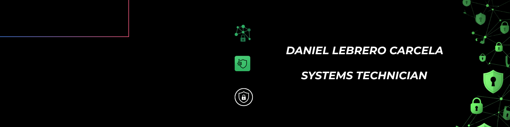

# Daniel Lebrero Carcela

**Sistemas, cloud y ciberseguridad aplicada · Systems, cloud & applied cybersecurity**

[Portfolio](https://danilebrero.github.io/daniel-lebrero-portfolio/) · [LinkedIn](https://www.linkedin.com/in/daniellebrerocarcela/) · [Contacto](mailto:daniellebrerocarcela@gmail.com)

[Español](#español) · [English](#english)

## Español

Trabajo en sistemas y soporte, desarrollo aplicaciones web y practico seguridad e infraestructura en mi laboratorio: construir, proteger y operar son partes del mismo trabajo.

### Experiencia

- **Soporte N1 y gestión de sistemas — IaaS365.** Gestión de accesos, permisos e incidencias con Entra ID y SharePoint.

### Proyectos y resultados

| Proyecto | Mi aportación y resultado | Evidencia |
| --- | --- | --- |
| **Top & Performance** | Desarrollo de una web de entrenamiento y nutrición, despliegue en Cloudflare Pages, DNS y SEO técnico. Canonical, sitemap, datos estructurados, AVIF y Open Graph. | [Web publicada](https://topandperformance.com/) · [Proceso y aprendizajes](https://es.linkedin.com/posts/daniellebrerocarcela_entrenamiento-personal-y-nutrici%C3%B3n-online-activity-7502451813326127104-26ju) |
| **BigShop · TFM de ciberseguridad** | Auditoría de caja gris en laboratorio sobre cuatro servicios web: **28 vulnerabilidades**, **3 críticas** e informe de **97 páginas** con puntuación CVSS. Seleccionado entre los **10 mejores TFM** de la primera edición de BIG school. | [Resultados y reconocimiento](https://es.linkedin.com/posts/daniellebrerocarcela_ciberseguridad-bigschool-top10-activity-7524202646979772418-u8uV) |
| **Homelab** | Configuración y operación de infraestructura propia con Docker: redes, persistencia, comprobaciones de salud y acceso privado. **51 contenedores en ejecución** en la revisión del **12 de noviembre de 2026**: 18 de entornos locales de Supabase y 33 del resto de servicios. | [Arquitectura y servicios](https://danilebrero.github.io/daniel-lebrero-portfolio/#laboratorio) |

La cifra del homelab es una instantánea comprobada con Docker. Cuenta contenedores, incluidos entornos de pruebas y componentes auxiliares como bases de datos y proxies; no equivale a 51 aplicaciones independientes ni a un estado en tiempo real.

Otros proyectos del portfolio: **yt-dlp Web** (Flask, autenticación, CSRF y SSRF), **Codeshare Local** (colaboración por WebSockets en red local) y **Lebre Services** (consulta de servicios con Docker API y Socket Proxy).

### Certificaciones

- **Microsoft Certified: Azure Fundamentals — AZ-900 aprobado.** [Publicación del logro](https://es.linkedin.com/posts/daniellebrerocarcela_azure-microsoftcertified-az900-activity-7517664563023151104-h9QU).
- Cursos de Cisco en redes, soporte, seguridad de endpoints, fundamentos de ciberseguridad, IA e IoT. [Detalle de credenciales](https://danilebrero.github.io/daniel-lebrero-portfolio/#certificaciones).

### Formación

- **Máster en Ciberseguridad — BIG school.** TFM realizado y seleccionado entre los diez mejores de la primera edición.
- Formación en **Ingeniería Informática — Universidad de Sevilla**.

### Herramientas con contexto

- **Soporte y cloud:** Entra ID, SharePoint y fundamentos de Azure.
- **Desarrollo:** Python, Flask, JavaScript, Node.js, WebSockets y SQL.
- **Laboratorio:** Linux, Docker, Nginx, PostgreSQL, WireGuard, Pi-hole, Uptime Kuma y Node Exporter.
- **Web publicada:** Cloudflare Pages, DNS, SEO técnico y Open Graph.
- **Seguridad aplicada:** autenticación, control de accesos, análisis de vulnerabilidades y documentación de impacto.

## English

I work in systems and support, build web applications, and practise security and infrastructure in my own lab: building, securing and operating software are parts of the same job.

### Experience

- **Tier 1 support and systems management — IaaS365.** Managing access, permissions and incidents with Entra ID and SharePoint.

### Projects and results

| Project | My contribution and outcome | Evidence |
| --- | --- | --- |
| **Top & Performance** | Built a training and nutrition website, deployed it on Cloudflare Pages, configured DNS and technical SEO. Implemented canonical URLs, sitemap, structured data, AVIF and Open Graph. | [Live website](https://topandperformance.com/) · [Process and lessons, in Spanish](https://es.linkedin.com/posts/daniellebrerocarcela_entrenamiento-personal-y-nutrici%C3%B3n-online-activity-7502451813326127104-26ju) |
| **BigShop · Cybersecurity final project** | Grey-box audit of four web services in a lab: **28 vulnerabilities**, including **3 critical findings**, documented in a **97-page report** with CVSS scores. Selected among the **10 best final projects** in the first BIG school cohort. | [Results and recognition, in Spanish](https://es.linkedin.com/posts/daniellebrerocarcela_ciberseguridad-bigschool-top10-activity-7524202646979772418-u8uV) |
| **Homelab** | Configured and operate Docker infrastructure: networks, persistence, health checks and private access. **51 running containers** checked on **12 November 2026**: 18 from local Supabase environments and 33 from all other services. | [Architecture and services](https://danilebrero.github.io/daniel-lebrero-portfolio/#laboratorio) |

The homelab count is a Docker snapshot. It counts containers, including test environments and supporting components such as databases and proxies; it does not mean 51 independent applications or a live status feed.

Other portfolio projects: **yt-dlp Web** (Flask, authentication, CSRF and SSRF), **Codeshare Local** (WebSocket collaboration on the local network) and **Lebre Services** (service visibility through Docker API and Socket Proxy).

### Certifications

- **Microsoft Certified: Azure Fundamentals — passed AZ-900.** [Achievement post, in Spanish](https://es.linkedin.com/posts/daniellebrerocarcela_azure-microsoftcertified-az900-activity-7517664563023151104-h9QU).
- Cisco courses covering networking, support, endpoint security, cybersecurity fundamentals, AI and IoT. [Credential details](https://danilebrero.github.io/daniel-lebrero-portfolio/#certificaciones).

### Education

- **Cybersecurity Master's programme — BIG school.** Completed the final project, selected among the ten best in the first cohort.
- Studies in **Computer Engineering — University of Seville**.

### Tools in practice

- **Support and cloud:** Entra ID, SharePoint and Azure fundamentals.
- **Development:** Python, Flask, JavaScript, Node.js, WebSockets and SQL.
- **Lab:** Linux, Docker, Nginx, PostgreSQL, WireGuard, Pi-hole, Uptime Kuma and Node Exporter.
- **Published website:** Cloudflare Pages, DNS, technical SEO and Open Graph.
- **Applied security:** authentication, access control, vulnerability analysis and impact documentation.

[Explorar proyectos / Explore projects](https://danilebrero.github.io/daniel-lebrero-portfolio/#proyectos)
